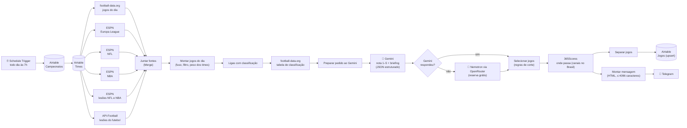
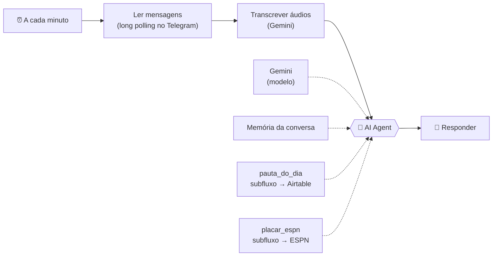
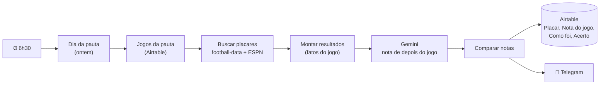

# Pauta de Jogos ⚽

Fluxo agêntico no **n8n** que, todo dia às 7h, levanta os jogos de futebol, da NFL e da NBA do dia e os desfalques (lesionados e suspensos) de cada time, usa um **LLM (Gemini)** para dar uma nota de relevância, escrever um briefing e apontar os desfalques que importam em cada jogo, guarda tudo no **Airtable** e manda a pauta pronta num bot do **Telegram**.

Feito para resolver uma dor real de quem trabalha com esporte: toda manhã alguém da produção precisa descobrir quais jogos acontecem, quais importam para o público brasileiro e o que dizer sobre cada um. Aqui isso chega pronto no celular antes do expediente.

**Custo: R$ 0.** Tudo roda em planos gratuitos (n8n self-hosted, Airtable Free, Gemini free tier, OpenRouter (modelos Nemotron :free), football-data.org free, API-Football free, ESPN pública, 365Scores pública, Telegram).

> 🎥 **Vídeo de demonstração (2 min):** _em breve_

---

## Como fica no Telegram

Mensagem real enviada pelo fluxo em 16/10/2026 (17 jogos analisados, 4 selecionados):

```
📅 Pauta de hoje: sexta-feira, 16/10
4 de 17 jogos selecionados · 🔥 jogão · ⭐ bom jogo

🇧🇷 BRASIL

Brasileirão Série A
⭐ 20:00 · Mirassol x Internacional
Internacional busca pontos fora de casa contra o Mirassol para se afastar da
zona de rebaixamento. O confronto é direto na parte inferior da classificação
da Série A.

🏀 NBA

⭐ 20:00 · 76ers x Celtics
76ers e Celtics fazem clássico de conferência na pré-temporada da NBA. É mais
um importante teste de ajustes para a temporada regular.

⭐ 21:00 · Bulls x Timberwolves
Bulls e Timberwolves duelam na pré-temporada da NBA. A equipe de Chicago busca
consolidar sua rotatividade de atletas.

⭐ 23:30 · Lakers x Nuggets
Lakers e Nuggets fazem um dos grandes jogos da rodada de pré-temporada da NBA.
O duelo coloca frente a frente duas potências da Conferência Oeste.
```

Os outros 13 jogos daquele dia (ligas europeias e o resto da rodada de pré-temporada da NBA) foram avaliados pelo LLM, ficaram abaixo da nota de corte ou do limite por campeonato e não entraram. Todos continuam registrados no Airtable com a nota e o motivo.

---

## Arquitetura



| Etapa | Nó no n8n | O que faz |
|---|---|---|
| 1 | **Schedule Trigger** | Dispara às 7h (fuso `America/Sao_Paulo`). |
| 2 | **Campeonatos** / **Times** (Airtable) | Lê a configuração mantida pela produção: quais campeonatos acompanhar, limites por campeonato e o peso de cada time. |
| 3 | **football-data** / **ESPN** / **ESPN NFL** / **ESPN NBA** (HTTP) | Busca os jogos. A football-data cobre Brasileirão, Libertadores, Champions e as 5 grandes ligas; a Europa League não está no plano grátis, então vem do endpoint público da ESPN, assim como a NFL (`football/nfl/scoreboard`, que já traz a campanha dos times, a semana e a TV) e a NBA (`basketball/nba/scoreboard`, que também marca pré-temporada, temporada regular e playoffs). As quatro são independentes, então saem lado a lado do nó Times e se encontram no **Juntar fontes** (Merge, modo Append), que espera todas terminarem. Sem ele, o nó seguinte rodaria uma vez por fonte e a pauta sairia triplicada. O n8n executa ramos um de cada vez, então isso deixa o fluxo mais legível, não mais rápido. |
| 3b | **ESPN NFL lesões** / **ESPN NBA lesões** / **API-Football lesões** (HTTP) | Busca os desfalques. A ESPN (`football/nfl/injuries`, `basketball/nba/injuries`) devolve a liga inteira numa chamada só, sem chave. As respostas completas são mantidas nos dois nós separados. A API-Football (`/injuries?date=hoje`) devolve os desfalques de todos os jogos de futebol do dia numa chamada, e o plano grátis permite 100 por dia. Também entram no **Juntar fontes**, agora com 7 entradas. Se alguma falhar, a pauta sai sem a linha de desfalques daquele esporte, com aviso. |
| 4 | **Montar jogos do dia** (Code) | Junta as quatro fontes num formato único, converte UTC para o horário de Brasília, mantém só os jogos da pauta (de hoje às 6h até amanhã às 6h, para não perder jogo da NBA que começa depois da meia-noite) e casa os nomes dos times com a tabela Times. Depois pendura em cada jogo os desfalques dos dois times: NFL e NBA pelo id do time na ESPN, futebol pelo horário de início e pelo nome do time (a API-Football usa ids próprios). |
| 5 | **Ligas com classificação** + **Classificação** | Para cada liga com jogo hoje (e que tenha tabela), busca a classificação, que vira contexto para o LLM. |
| 6 | **Preparar pedido ao Gemini** + **Gemini** | Monta o prompt com critérios explícitos de nota e pede a resposta em JSON com `responseSchema` fixo. |
| 6b | **Gemini respondeu?** (IF) + **Nemotron (reserva)** (HTTP) | Se o Gemini não devolveu texto (503 de alta demanda, cota estourada), o mesmo prompt vai ao OpenRouter, numa fila de modelos Nemotron grátis da NVIDIA: `nemotron-3-super-120b-a12b`, depois `nemotron-3-ultra-550b-a55b`, depois `nemotron-3.5-super-vl`. Quem troca de modelo quando um está sobrecarregado é o próprio OpenRouter (parâmetro `models`), numa chamada só. O pedido sai pronto do nó **Preparar pedido ao Gemini**, com o schema convertido para o formato da OpenAI. |
| 7 | **Selecionar jogos** (Code) | Aplica as regras de corte (abaixo). Lê a resposta do Gemini ou, se ele falhou, a do Nemotron. Se os dois falharem, calcula a nota pelo peso dos times e o resumo sai mesmo assim. |
| 7b | **Pedidos 365Scores** → **365Scores jogos** → **Casar transmissões** → **365Scores transmissão** → **Adicionar transmissão** | Descobre onde passa cada jogo selecionado, usando a API pública do site da 365Scores (sem chave, `userCountryId=21` = canais do Brasil). Uma chamada de lista por esporte (futebol, basquete, futebol americano) e uma de detalhe por jogo que tem transmissão. Os ids não batem com os da football-data/ESPN, então o jogo é casado pelo horário (±15 min) e pelo nome dos times, a mesma regra usada com a API-Football. Roda depois da seleção para buscar só o que vai para a pauta. Se a 365Scores falhar, a pauta sai sem a linha 📺, com aviso. |
| 8 | **Salvar no Airtable** | *Upsert* pela coluna `ID`: rodar duas vezes no mesmo dia atualiza em vez de duplicar. |
| 9 | **Montar mensagem** + **Telegram** | Monta uma mensagem só, com blocos Brasil / Copas / Europa / 🏈 NFL / 🏀 NBA. Só divide em mais de uma se passar do limite de 4096 caracteres do Telegram. |

O código de todos os nós Code está em [`n8n/code/`](n8n/code), comentado.

---

## Bot que responde perguntas (AI Agent)

Além da pauta das 7h, o mesmo bot do Telegram responde perguntas a qualquer hora, por texto ou **áudio**: "qual o jogão de hoje?", "onde passa o jogo do Flamengo?", "quanto está o jogo dos Chiefs?". Quem responde é um **AI Agent** do n8n, que decide sozinho qual ferramenta consultar.



| Peça | O que faz |
|---|---|
| **Ler mensagens** (Code) | Chama o `getUpdates` do Telegram com `timeout=30`. O Telegram segura a conexão até chegar mensagem (*long polling*), então a resposta sai em segundos mesmo com o gatilho a cada minuto. Confirma a leitura (offset = último id + 1) **antes** de responder, para uma execução sobreposta não responder a mesma mensagem duas vezes. Só aceita o chat do `TELEGRAM_CHAT_ID`. |
| **Transcrever áudios** (Code) | Mensagem de voz: `getFile` → baixa o `.ogg` → manda ao Gemini em base64 pedindo a transcrição. O texto vira a pergunta do agente, que continua trabalhando só com texto. A resposta mostra o que foi entendido (🎤). Limite de 3 minutos por áudio. |
| **AI Agent** + **Gemini** | Recebe a pergunta, a data de hoje e as regras (não inventar placar, canal ou desfalque; texto curto, sem Markdown). Tenta 3 vezes se o Gemini falhar e, no fim, avisa em vez de ficar mudo. |
| **Memória da conversa** | Guarda as últimas 6 trocas do chat, para "e o do Flamengo?" funcionar depois de outra pergunta. Fica na memória do n8n e zera quando ele reinicia. |
| **pauta_do_dia** (subfluxo `Bot - pauta do dia`) | Busca na tabela Jogos os jogos da pauta de um dia e troca o id do link pelo nome do campeonato. Tem nota, briefing, desfalques e transmissão. |
| **placar_espn** (subfluxo `Bot - placar ESPN`) | Placar, situação e campanhas de uma liga num dia, direto da ESPN (11 ligas). Reduz a resposta da ESPN (216 KB numa rodada da NFL) para ~2 KB antes de chegar ao modelo. |

Por que essas escolhas:
- **Polling e não webhook:** o n8n roda no PC, sem endereço público. Webhook exigiria um túnel com URL que muda a cada reinício. O long polling funciona em localhost e é quase tão rápido.
- **Ferramentas como subfluxos:** cada ferramenta pode limpar e encolher os dados antes de o LLM ver. Menos tokens, menos alucinação e a cota grátis rende mais.
- **Chamadas ao Telegram dentro de nó Code:** o token do bot vai na URL. Quando um nó HTTP falha, o n8n grava a URL inteira no log de erro. No nó Code o erro é tratado e sai sem o token (e sem a chave do Gemini).

---

## Como foram os jogos (a nota acertou?)

Às 6h30, antes da pauta nova, o workflow **Como foram os jogos** pega os jogos da pauta de ontem, busca o resultado e pede ao Gemini uma **nota de depois do jogo**, na mesma escala de 1 a 5. Depois compara com a nota que a pauta deu de manhã. O resultado vai para o Telegram e para o Airtable. Com o tempo, a tabela Jogos mostra se as notas acertam e em que tipo de jogo elas erram.



Na mensagem, os jogos aparecem em três grupos: 📈 os que **surpreenderam** (2 pontos ou mais acima da nota da pauta), 📉 os que **decepcionaram** (2 ou mais abaixo) e 🎯 os que saíram **como previsto**. No topo vem o placar do acerto, por exemplo *"7 de 15 na mosca · 7 por 1 ponto · 1 errou por 2 ou mais"*.

| Peça | O que faz |
|---|---|
| **Buscar placares** (Code) | Placar oficial pela football-data (uma chamada com todos os ids). "Como foi" pela ESPN, numa chamada por liga e por dia: minuto e autor dos gols, expulsões, posse, chutes no gol e, na NBA e na NFL, placar por quarto, prorrogação, destaques e a manchete do jogo. As respostas da ESPN são enxugadas para ~2 KB por liga. |
| **Montar resultados** (Code) | Acha cada jogo da football-data na ESPN pelo horário (±15 min) e pelo nome dos times, e calcula os fatos: virada, empate arrancado, gol decisivo a partir dos 85', goleada, prorrogação ou pênaltis. |
| **Preparar avaliação** + **Gemini** | Pede a nota de depois do jogo e uma frase de "como foi". O modelo recebe o contexto de antes do jogo (o briefing), **mas não a nota prevista**. |
| **Comparar notas** (Code) | Mesma nota: *Na mosca*. 1 ponto de diferença: *Perto*. 2 ou mais: *Superou* ou *Decepcionou*. |

Por que essas escolhas:
- **Avaliação cega à nota da manhã.** Se o modelo visse o "4" da pauta, tenderia a confirmar o número. Sem ele, a comparação mede alguma coisa. O limite: o mesmo modelo dá as duas notas, então isso mede a coerência do Gemini com ele mesmo, não com um editor humano. O próximo passo natural é a produção corrigir a coluna *Nota do jogo* quando discordar, criando um gabarito humano.
- **Os fatos são calculados no código, não pelo LLM.** Virada, gol aos 89' e margem de pontos saem da linha do tempo da ESPN. O modelo só interpreta, e o prompt proíbe citar jogador ou lance que não esteja nos fatos. No teste com a pauta real de 17/10, todos os detalhes das frases (gol aos 7', expulsão aos 43', virada do PSG) batiam com os dados.
- **Placar da football-data, detalhes da ESPN.** A football-data casa pelo id, então o placar é exato. O plano grátis dela não traz os gols, e a ESPN traz. Se a ESPN não achar o jogo, ele sai só com o placar e o intervalo, que ainda mostra virada no segundo tempo.
- **Um workflow separado, não mais nós na pauta.** O resumo de ontem pode falhar, ou ser desligado, sem afetar a pauta das 7h. Também fica mais fácil de testar e de explicar.
- **O que os primeiros testes mostraram:** na pré-temporada da NBA, a pauta deu nota 4 para seis jogos. Três viraram passeio de mais de 15 pontos (4 → 2), e só o 76ers x Celtics, decidido na prorrogação, subiu para 5. É o tipo de padrão que serve para ajustar o prompt da pauta.

---

## Regras de seleção

| Campeonato | O que entra |
|---|---|
| Brasileirão e Libertadores | **Todos os jogos** |
| Champions League | Nota 5 sempre + até **4** jogos nota 4 |
| Premier League | Nota 5 sempre + até **3** jogos nota 4 |
| Demais (La Liga, Serie A, Bundesliga, Ligue 1, Europa League) | Nota 5 sempre + até **2** jogos nota 4 |

Os limites ficam na tabela **Campeonatos** do Airtable (colunas *Todos os jogos* e *Limite nota 4*). A produção muda a regra sem mexer no fluxo.

### O que o LLM recebe e devolve

Para cada jogo o Gemini recebe campeonato, fase, rodada, horário, a posição dos dois times na tabela, o peso de cada time e a lista de desfalques de cada lado. O prompt define o que é nota 5 (clássico, confronto direto no topo, decisão) até nota 1, proíbe inventar escalações ou resultados recentes e manda citar só os desfalques da lista. A resposta vem em JSON validado por schema:

```json
{ "jogos": [ { "id": "fd-123", "nota": 4, "motivo": "...", "briefing": "...", "desfalques": "Pedro (Flamengo, fora)" } ] }
```

---

## Decisões de projeto

- **Por que Gemini (`gemini-flash-lite-latest`)?** Tem plano gratuito com cota suficiente para uma chamada por dia. Os modelos `flash` maiores devolveram erro 503 de alta demanda nos testes, e o `flash-lite` respondeu de forma estável com qualidade suficiente para notas e briefings curtos. A escolha foi por custo, cota e estabilidade.
- **Desfalques vêm da fonte, não do LLM.** O Gemini só escolhe quais desfalques da lista importam. Antes de ir para a mensagem, o nó **Selecionar jogos** descarta qualquer nome que não esteja na lista da ESPN ou da API-Football.
- **Limpeza do histórico de execuções.** Os nós HTTP de lesões mantêm as respostas completas da ESPN (~10 MB por execução), por escolha do usuário. O `start-n8n.ps1` mantém a limpeza automática: execuções com mais de 7 dias são apagadas, e o SQLite é compactado ao iniciar.
- **Transmissão vem de uma API não oficial.** A 365Scores não documenta a API do site, então ela pode mudar sem aviso. Por isso os nós têm `onError: continue` e a falha só tira a linha 📺 da mensagem. Ela é buscada depois da seleção, não antes, porque não influencia a nota.
- **Uma chamada só ao LLM por dia**, com todos os jogos no mesmo pedido. Economiza cota e deixa o modelo comparar os jogos entre si.
- **Modelo de reserva: Nemotron via OpenRouter.** O Gemini grátis às vezes devolve 503 de alta demanda. Em 17/10/2026 foram testados os Nemotron gratuitos do OpenRouter com o prompt real (21 jogos): o **Super 120B** com raciocínio desligado respondeu em ~30 s com notas quase iguais às do Gemini (13 de 21 iguais, os outros 8 a só 1 ponto de diferença); com raciocínio ligado levava ~150 s sem ganho visível. O **Ultra 550B** estava sobrecarregado nos testes, o **3.5 Lightning** não respondeu em 4 min e o **3.5 Super VL** respondeu rápido mas deu notas mais baixas na NFL. Daí a fila Super → Ultra → Super VL. O plano grátis do OpenRouter dá 50 pedidos por dia, e o fluxo usa no máximo 1 (só quando o Gemini falha). A mensagem avisa (ℹ️) quando a pauta foi feita pela reserva.
- **Falha não derruba o resumo.** O nó Gemini tenta de novo com intervalo de 5 s; se continuar falhando, entra o Nemotron; se ele também falhar, a nota sai do peso dos times e a mensagem avisa que foi sem LLM. Se a ESPN cair, o resumo sai sem a Europa League, a NFL ou a NBA, com aviso.
- **Configuração no Airtable, não no código.** Campeonatos, limites e peso dos times são editáveis por quem não programa. Ver o [manual de uso](docs/MANUAL.md).
- **Segredos fora do fluxo.** Tokens ficam no `.env` e nas credenciais do n8n. O JSON exportado neste repositório não tem nenhuma chave.

---

## Estrutura do repositório

```
├── n8n/
│   ├── workflow-pauta-de-jogos.json   # fluxo principal (importar no n8n)
│   ├── workflow-smoke-test.json       # testa as 4 APIs de uma vez
│   ├── workflow-bot-da-pauta.json     # bot que responde perguntas (AI Agent)
│   ├── workflow-bot-pauta-do-dia.json # ferramenta do bot: pauta no Airtable
│   ├── workflow-bot-placar-espn.json  # ferramenta do bot: placar da ESPN
│   ├── workflow-como-foram-os-jogos.json # resultado da pauta de ontem × nota prevista
│   └── code/                          # código de cada nó Code, comentado
├── airtable/
│   ├── campeonatos.csv                # configuração dos campeonatos
│   ├── times.csv                      # 45 times de futebol com peso e grafias nas APIs
│   ├── times-nfl.csv                  # 32 times da NFL (importar na mesma tabela Times)
│   └── times-nba.csv                  # 30 times da NBA (importar na mesma tabela Times)
├── docs/MANUAL.md                     # manual para a produção
├── start-n8n.ps1                      # sobe o n8n local carregando o .env
├── .env.example
└── ROADMAP.md                         # próximos passos e ideias
```

---

## Como rodar

**Pré-requisitos:** Node.js 20–24 (o n8n ainda não roda no Node 26) e contas gratuitas em [football-data.org](https://www.football-data.org/client/register), [API-Football](https://dashboard.api-football.com/register), [Google AI Studio](https://aistudio.google.com/apikey), [OpenRouter](https://openrouter.ai/keys) (opcional, modelo de reserva), [Airtable](https://airtable.com) e um bot criado no [@BotFather](https://t.me/BotFather).

1. **Airtable:** crie uma base com as tabelas `Campeonatos`, `Times` e `Jogos` (campos descritos no [manual](docs/MANUAL.md#estrutura-do-airtable)) e importe os CSVs da pasta `airtable/`. Gere um *personal access token* com acesso a essa base.
2. **Segredos:** copie `.env.example` para `.env` e preencha.
3. **n8n:** instale (`npm install n8n`) e suba com `.\start-n8n.ps1`, ajustando no topo do script o caminho do n8n e do Node. O script carrega o `.env` e libera `{{ $env.* }}` nos nós.
4. **Importe** `n8n/workflow-pauta-de-jogos.json` e crie as credenciais que os nós pedem:
   - *Airtable Personal Access Token*
   - *Header Auth* `X-Auth-Token` para a football-data.org
   - *Header Auth* `x-goog-api-key` para o Gemini
   - *Header Auth* `x-apisports-key` para a API-Football (nome da credencial: `API-Football`)
   - *Telegram API* com o token do bot
5. Rode o `workflow-smoke-test.json` para conferir as quatro APIs, execute o fluxo principal manualmente uma vez e depois ative-o.
6. **Bot (opcional):** importe primeiro os dois subfluxos (`workflow-bot-pauta-do-dia.json` e `workflow-bot-placar-espn.json`) e publique-os. Depois importe `workflow-bot-da-pauta.json`, escolha os subfluxos nos nós `pauta_do_dia` e `placar_espn`, crie uma credencial *Google Gemini (PaLM) API* (nome `Gemini`) e ative. O bot usa `TELEGRAM_BOT_TOKEN`, `TELEGRAM_CHAT_ID` e `GEMINI_API_KEY` do `.env`.
7. **Como foram os jogos (opcional):** crie na tabela Jogos as colunas `Placar` (texto), `Nota do jogo` (número), `Como foi` (texto longo) e `Acerto da nota` (seleção). Importe `workflow-como-foram-os-jogos.json`, escolha as mesmas credenciais de Airtable, Gemini e Telegram e rode uma vez à mão. O nó `Buscar placares` usa `FOOTBALL_DATA_TOKEN` do `.env`. Para revisar outro dia, troque a data no nó `Dia da pauta`.

> O n8n roda local, então o gatilho das 7h só dispara com o PC ligado. Para produção, o mesmo fluxo roda em um servidor ou no n8n Cloud sem alterações.

---

## Próximos passos

Ver o [ROADMAP](ROADMAP.md): NBA pelo mesmo endpoint da ESPN na mensagem e um formulário no Airtable para a equipe pedir cobertura de um jogo.
