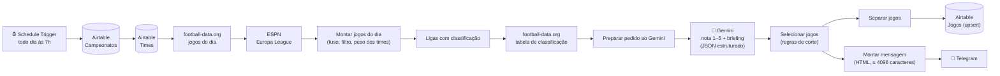

# Pauta de Jogos ⚽

Fluxo agêntico no **n8n** que, todo dia às 7h, levanta os jogos de futebol do dia, usa um **LLM (Gemini)** para dar uma nota de relevância e escrever um briefing de cada jogo, guarda tudo no **Airtable** e manda a pauta pronta num bot do **Telegram**.

Feito para resolver uma dor real de quem trabalha com esporte: toda manhã alguém da produção precisa descobrir quais jogos acontecem, quais importam para o público brasileiro e o que dizer sobre cada um. Aqui isso chega pronto no celular antes do expediente.

**Custo: R$ 0.** Tudo roda em planos gratuitos (n8n self-hosted, Airtable Free, Gemini free tier, football-data.org free, ESPN pública, Telegram).

> 🎥 **Vídeo de demonstração (2 min):** _em breve_

---

## Como fica no Telegram

Mensagem real enviada pelo fluxo em 16/10/2026 (5 jogos analisados, 1 selecionado):

```
📅 Pauta de hoje: sexta-feira, 16/10
1 de 5 jogos selecionados · 🔥 jogão · ⭐ bom jogo

🇧🇷 BRASIL

Brasileirão Série A
⭐ 20:00 · Mirassol x Internacional
Mirassol e Internacional fazem um duelo de seis pontos na parte inferior da
tabela do Brasileirão. Ambas as equipes precisam desesperadamente da vitória
para se afastar da zona de rebaixamento.
```

Os jogos de La Liga, Serie A, Bundesliga e Ligue 1 daquele dia foram avaliados pelo LLM, ficaram abaixo da nota de corte e não entraram. Todos continuam registrados no Airtable com a nota e o motivo.

---

## Arquitetura



| Etapa | Nó no n8n | O que faz |
|---|---|---|
| 1 | **Schedule Trigger** | Dispara às 7h (fuso `America/Sao_Paulo`). |
| 2 | **Campeonatos** / **Times** (Airtable) | Lê a configuração mantida pela produção: quais campeonatos acompanhar, limites por campeonato e o peso de cada time. |
| 3 | **football-data** / **ESPN** (HTTP) | Busca os jogos. A football-data cobre Brasileirão, Libertadores, Champions e as 5 grandes ligas; a Europa League não está no plano grátis, então vem do endpoint público da ESPN. |
| 4 | **Montar jogos do dia** (Code) | Junta as duas fontes num formato único, converte UTC para o horário de Brasília, mantém só os jogos de hoje e casa os nomes dos times com a tabela Times. |
| 5 | **Ligas com classificação** + **Classificação** | Para cada liga com jogo hoje (e que tenha tabela), busca a classificação, que vira contexto para o LLM. |
| 6 | **Preparar pedido ao Gemini** + **Gemini** | Monta o prompt com critérios explícitos de nota e pede a resposta em JSON com `responseSchema` fixo. |
| 7 | **Selecionar jogos** (Code) | Aplica as regras de corte (abaixo). Se o Gemini falhar, calcula a nota pelo peso dos times e o resumo sai mesmo assim. |
| 8 | **Salvar no Airtable** | *Upsert* pela coluna `ID`: rodar duas vezes no mesmo dia atualiza em vez de duplicar. |
| 9 | **Montar mensagem** + **Telegram** | Agrupa em Brasil / Copas / Europa e divide em várias mensagens se passar do limite do Telegram. |

O código de todos os nós Code está em [`n8n/code/`](n8n/code), comentado.

---

## Regras de seleção

| Campeonato | O que entra |
|---|---|
| Brasileirão e Libertadores | **Todos os jogos** |
| Champions League | Nota 5 sempre + até **4** jogos nota 4 |
| Premier League | Nota 5 sempre + até **3** jogos nota 4 |
| Demais (La Liga, Serie A, Bundesliga, Ligue 1, Europa League) | Nota 5 sempre + até **2** jogos nota 4 |

Os limites ficam na tabela **Campeonatos** do Airtable (colunas *Todos os jogos* e *Limite nota 4*). A produção muda a regra sem mexer no fluxo.

### O que o LLM recebe e devolve

Para cada jogo o Gemini recebe campeonato, fase, rodada, horário, a posição dos dois times na tabela e o peso de cada time. O prompt define o que é nota 5 (clássico, confronto direto no topo, decisão) até nota 1 e proíbe inventar lesões, escalações ou resultados recentes. A resposta vem em JSON validado por schema:

```json
{ "jogos": [ { "id": "fd-123", "nota": 4, "motivo": "...", "briefing": "..." } ] }
```

---

## Decisões de projeto

- **Por que Gemini (`gemini-flash-lite-latest`)?** Tem plano gratuito com cota suficiente para uma chamada por dia. Os modelos `flash` maiores devolveram erro 503 de alta demanda nos testes, e o `flash-lite` respondeu de forma estável com qualidade suficiente para notas e briefings curtos. A escolha foi por custo, cota e estabilidade.
- **Uma chamada só ao LLM por dia**, com todos os jogos no mesmo pedido. Economiza cota e deixa o modelo comparar os jogos entre si.
- **Falha não derruba o resumo.** O nó Gemini tenta de novo com intervalo de 5 s e, se continuar falhando, a nota sai do peso dos times e a mensagem avisa que foi sem LLM. Se a ESPN cair, o resumo sai sem a Europa League, com aviso.
- **Configuração no Airtable, não no código.** Campeonatos, limites e peso dos times são editáveis por quem não programa. Ver o [manual de uso](docs/MANUAL.md).
- **Segredos fora do fluxo.** Tokens ficam no `.env` e nas credenciais do n8n. O JSON exportado neste repositório não tem nenhuma chave.

---

## Estrutura do repositório

```
├── n8n/
│   ├── workflow-pauta-de-jogos.json   # fluxo principal (importar no n8n)
│   ├── workflow-smoke-test.json       # testa as 4 APIs de uma vez
│   └── code/                          # código de cada nó Code, comentado
├── airtable/
│   ├── campeonatos.csv                # configuração dos campeonatos
│   └── times.csv                      # 45 times com peso e grafias nas APIs
├── docs/MANUAL.md                     # manual para a produção
├── start-n8n.ps1                      # sobe o n8n local carregando o .env
├── .env.example
└── ROADMAP.md                         # próximos passos (NFL, NBA...)
```

---

## Como rodar

**Pré-requisitos:** Node.js 20–24 (o n8n ainda não roda no Node 26) e contas gratuitas em [football-data.org](https://www.football-data.org/client/register), [Google AI Studio](https://aistudio.google.com/apikey), [Airtable](https://airtable.com) e um bot criado no [@BotFather](https://t.me/BotFather).

1. **Airtable:** crie uma base com as tabelas `Campeonatos`, `Times` e `Jogos` (campos descritos no [manual](docs/MANUAL.md#estrutura-do-airtable)) e importe os CSVs da pasta `airtable/`. Gere um *personal access token* com acesso a essa base.
2. **Segredos:** copie `.env.example` para `.env` e preencha.
3. **n8n:** instale (`npm install n8n`) e suba com `.\start-n8n.ps1`, ajustando no topo do script o caminho do n8n e do Node. O script carrega o `.env` e libera `{{ $env.* }}` nos nós.
4. **Importe** `n8n/workflow-pauta-de-jogos.json` e crie as credenciais que os nós pedem:
   - *Airtable Personal Access Token*
   - *Header Auth* `X-Auth-Token` para a football-data.org
   - *Header Auth* `x-goog-api-key` para o Gemini
   - *Telegram API* com o token do bot
5. Rode o `workflow-smoke-test.json` para conferir as quatro APIs, execute o fluxo principal manualmente uma vez e depois ative-o.

> O n8n roda local, então o gatilho das 7h só dispara com o PC ligado. Para produção, o mesmo fluxo roda em um servidor ou no n8n Cloud sem alterações.

---

## Próximos passos

Ver o [ROADMAP](ROADMAP.md): NFL e NBA pelo mesmo endpoint da ESPN, separação por esporte na mensagem e um formulário no Airtable para a equipe pedir cobertura de um jogo.
